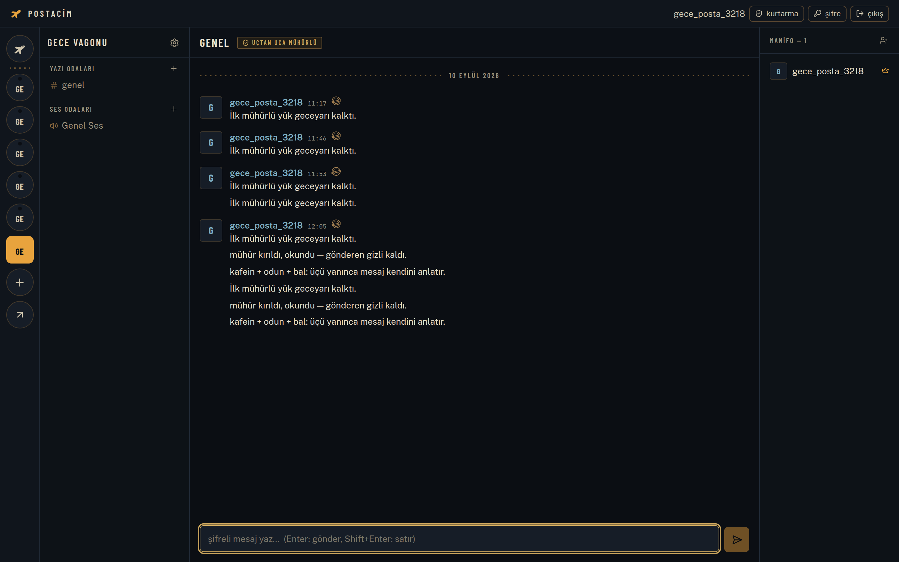
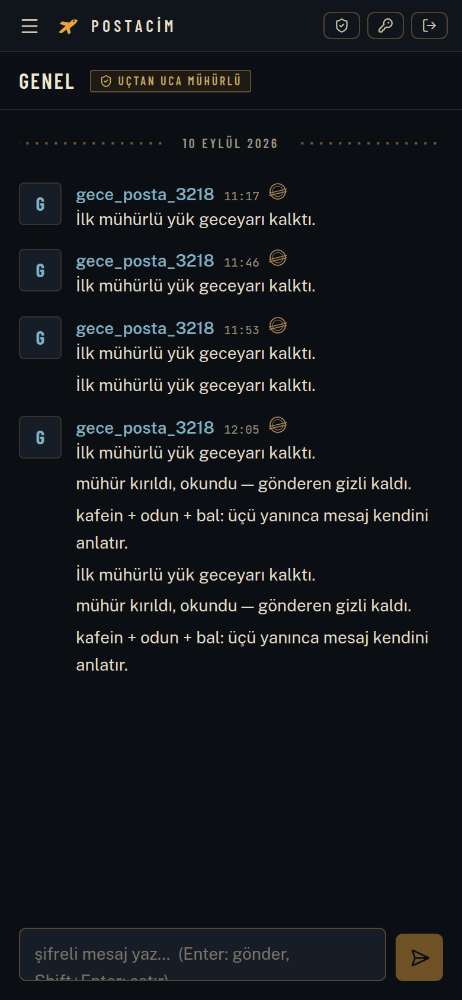
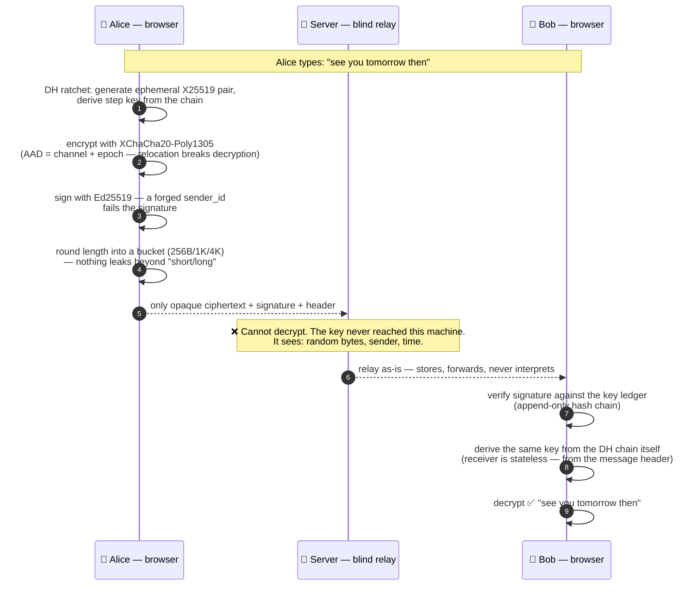
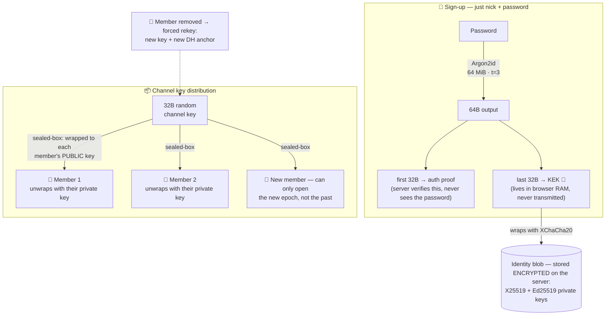

# postacim 🕊️

[](https://github.com/yucOx/postacim/actions/workflows/ci.yml)
[](#automated-tests)

**[Türkçe](README.md)** · English

Privacy-focused, end-to-end encrypted (E2EE) Discord-style chat. The server
only relays ciphertext — it **never** sees plaintext messages, audio, video,
or keys.

Hosted instance: **https://postacim.dev** · Desktop app: [postacim-cli](#desktop-app)

| Desktop | Mobile |
|---|---|
|  |  |

## Features

- **Sign-up: nick + password only** — no email/phone, zero-knowledge; during
  registration a **BIP-39 recovery phrase** ritual (12 words, verify 3,
  download as text file) — identity and history survive a lost password
- **Text channels** — encrypted client-side with XChaCha20-Poly1305,
  real-time over WebSocket
- **Disappearing messages** — per-message TTL in the composer
  (off / 1 hour / 1 day / 1 week), remembered per channel and DM/group;
  expired messages become tombstones on the server and render as "expired"
  client-side (TTL is server-visible metadata — see Known limits)
- **Voice/video rooms** — true E2EE via SFrame over a LiveKit SFU, dozens
  of participants
- **Communities** — Discord-style server → channel structure, owner/member
  roles
- **Key distribution** — channel keys wrapped to each member with sealed
  boxes; the server cannot open them
- **Member removal = mandatory rekey** — after a member is kicked/banned,
  channels **lock**: messaging, voice rooms, invite generation/use and
  member-adding stay closed until an owner or admin "renews the key" (the
  old key is at risk). A removed member cannot return via a leftover invite
  and read; if they were in a voice room, their live connection is dropped.
- **Password change** — identity blob is re-wrapped, channel keys untouched;
  changing it **drops every session** (including stolen tokens)
- **Multi-device** (Phase 7) — each device has an independent
  X25519+Ed25519 keypair (identity blob v3, `device_id`); Settings →
  Devices lists devices, linking is WS-based (primary approval), revoking
  a device forces a rekey. Per-device DH step: different devices of the
  same user keep separate step counters — a state leak on one device does
  not affect the other
- **Screen sharing** — over the same E2EE path; **Go Live dialog**:
  resolution × fps × source type (screen/window/tab) × tab/system audio,
  bitrate table matched to Discord's Go Live targets
- **Call experience** (Discord layout) — focus/grid stage switching,
  speaking glow, in-call side chat (split view), minimize-to-corner (PiP —
  draggable + pin above everything), **right-click menu**: per-participant
  volume/mute and stream-audio control, ping indicator in the control bar;
  **always-on-top call window** (browser Document Picture-in-Picture —
  floats above every other app, also in the desktop app)
- **Mobile background behavior** — while a call is live, a silent keepalive
  audio + MediaSession keeps the tab's audio pipeline alive when backgrounded
  (Android doesn't cut the mic; Chrome may trigger automatic PiP); if the
  camera is on without PiP, the publish honestly switches to "camera off" —
  peers see a clean signal instead of a frozen frame — and re-enables
  automatically on return. Presence survives too: even if the mobile OS
  kills the presence WS, the server keeps the user in the room for a
  120 s grace and the client re-announces on reconnect. **iOS honest
  limit:** Safari never streams the camera from a backgrounded web app
  (a native app is required); the mic usually survives via the keepalive
- **Device selection** — mic/camera/speaker; from the in-call menu or
  Settings → Voice & Video, persisted, applied instantly mid-call; speaker
  choice persists across calls and applies to participants who join later
- **Notification sounds** (Discord parity) — 15 events: message, mention,
  incoming call, invite, friend request, room join/leave, mic on/off,
  stream start/stop, camera on/off, deafen/undeafen. Each can be
  **individually disabled** in Settings → Notifications and previewed with
  a Listen button; melodic ones are MP3, short clicks are synthesized with
  WebAudio

### Moderation and membership

- **Roles**: owner → admin → member. Admins: add/remove members + rekey,
  ban, channels, invites, application approval. Promoting admins and the
  join password are owner-only. Adding a member is **consent-based**: the
  target gets an invite prompt; membership lands only on acceptance.
- **Community profile**: owner/admins rename the community and set a photo
  from ⚙️ — plain metadata (like channel names), never touches keys; visible
  to members only.
- **Permanent bans**: banned members cannot be re-added, use invites, or
  apply; the ban list is managed under ⚙️.
- **Invite links** (`↗` → generate): **open** invites — the private half of
  an ephemeral X25519 key travels in the link's `#` fragment, joining works
  even while the owner is offline; **targeted** invites — keys are wrapped
  directly to the target's identity, a leaked code is useless to anyone
  else. Usage/duration limits, revocation.
- **Applications**: anyone knowing the community name can apply (`↗`);
  on owner/admin approval keys are wrapped to their identity; re-applying
  after a rejection is allowed.
- **Join password** (owner, ⚙️ → Password): an optional second factor on
  top of the invite link. The Argon2id-derived key wraps channel keys —
  the server only ever sees a verifier.
- **Communities are private**: they are listed nowhere; only members see
  them. Knowing the name is merely an application signal.

### Friends, DMs and calls

- **Friending** (🕊️): send a request by nick; accept/decline. Only friends
  can open DMs — strangers cannot message you.
- **Direct messages (DM)**: two-person E2EE channel; the key is wrapped by
  the opening party to both identities with sealed boxes, DM messages are
  XChaCha20-Poly1305 encrypted with `dm:`-scoped AAD. Unfriending closes
  sending; history stays readable.
- **Group DM** (🕊️ → + group): build a group from friends; keys rotate on
  membership changes — a new member cannot read older messages, a departing
  one cannot read future ones; remaining members read the full history with
  epoch keys.
- **1:1 calls**: 📞 in a DM — ring on the other side (WebAudio) +
  accept/decline; on acceptance both sides join the LiveKit room with the
  same DM key over SFrame E2EE. Busy means auto-decline; if the other side
  stays in the room after you leave, a green "in a call" banner with
  one-click rejoin appears in the DM (survives reload — WS presence)
- **Unread state**: dot + counter in channel/DM lists, 🕊️ badge, `(n)` in
  the tab title, notification sound for background DMs. Read state is
  client-only — the server never knows what you read.

## How it works — nobody can read your messages

The server is a post office: it carries envelopes but **can never open one**.
Every layer is blind by design — a network listener hits TLS, the server hits
encryption, the media server hits SFrame. Below is the real path of a message,
from the moment it is typed to the moment it is read. An animated, login-free
version of this walkthrough lives in the app at `/#/nasil-calisir`.

### 1. A message's journey



In the server's database that message looks **like this** — check it yourself
with the command in the [manual test](#manual-test-two-browser-profiles)
section:

```
{ nonce: '9f3a1c…', ciphertext: 'c8e2b41d77a0f6…' }   ← nothing readable inside
```

### 2. Keys never leave the browser



If the password is lost: the BIP-39 recovery phrase (12 words) restores the
identity — the phrase itself is end-to-end wrapped, so **the server cannot
open it either**; lose both and the account is gone. That is the price of E2EE.

### 3. Voice, video and screen share follow the same pipe

```mermaid
flowchart LR
    MIC["🎤 Alice<br/>mic/camera/screen"] -->|"browser encrypts with SFrame<br/>frame by frame"| C1["🔒 encrypted RTP"]
    C1 --> SFU["LiveKit SFU<br/>— media server routes<br/>opaque bytes only"]
    SFU --> C2["🔒 encrypted RTP"]
    C2 -->|"key = H(DH chain ‖ 'voice')<br/>zero extra trust for media"| EAR["🎧 Bob"]
    style SFU fill:#1a1a2e,stroke:#888
```



The voice-room key is derived from the message chain (`H(step_root ‖ 'voice')`)
— meaning "everyone who can read the channel can hear the voice, nobody else
can". What the SFU sees: bytes. Not what is said, not what is shared.

### 4. Who sees what — and what nobody sees

| | Sees | Cannot see |
|---|---|---|
| **Network listener** (ISP, WiFi) | TLS traffic size/timing | content, nick, keys |
| **Server** (even if malicious) | opaque ciphertext, sender identity, time, length bucket | message, voice, video, keys, password |
| **LiveKit SFU** | encrypted frame bytes, who is connected | spoken/shared content |
| **A removed member** | whatever their old epoch keys already opened | **any new message after the rekey** (DH-rekey + PCS-lite) |

> The guarantee rests not on this machine but on **math**: opening
> XChaCha20-Poly1305 or X25519 requires the key; keys are derived only inside
> members' browsers and never travel in the clear. The server's "blindness" is
> also test-enforced — `server/test/hardening.test.ts` automatically fails if
> plaintext ever touches the database, on every CI run.

## Cryptography

| Purpose | Method |
|---|---|
| Password → key derivation | Argon2id (64 MiB, t=3), 64B output: first 32B auth proof (argon2id verifier on the server), last 32B KEK (never leaves the browser) |
| Identity | X25519 keypair + **Ed25519 signing keypair**; private keys live on the server as a KEK-encrypted XChaCha20-Poly1305 blob. **Blob evolution:** v1 = X25519 priv; v2 = `0x02 ‖ X25519 ‖ Ed25519` (Phase 1); v3 = `0x03 ‖ X25519 ‖ Ed25519 ‖ 16B device_id` (Phase 7). Older blobs auto-upgrade on first unlock; v1/v2 accounts continue as primary aliases with `deviceId = null` |
| Channel key | 32B random; wrapped to members with `crypto_box_seal` (sealed box) |
| Messages | XChaCha20-Poly1305, AAD = `ch:<channel>:v<epoch>` (relocation-resistant) |
| Sender attribution | Every message is **signed with the sender's Ed25519 key** (`ciphertext‖signature` over ciphertext+AAD); receivers verify against the key log before decrypting — the server cannot forge messages with a fake sender_id. Unsigned messages are rejected after the cutover date |
| DH ratchet (v4, all scopes) | Every message carries an ephemeral X25519 public; the DH output mixes into the chain, stepping every 100 messages / 24 h, ephemeral private discarded → **a stolen current chain state cannot produce the future from the next step on** (forward secrecy). In DMs the anchor derives from the deterministically-ordered (me, peer) identity pair (`dhAnchor` — 5b hotfix; our own messages decrypt too); channels/group DMs use a group DH anchor derived from the epoch key — all members derive the same pair and receivers stay stateless: the chain can be re-derived from message headers (natural for pagination/localStorage loss). Pre-fix v4 DMs are unreadable (one-time format break) |
| Voice/video | The SFrame key derives from the channel key's DH chain (5d): `H(step_root ‖ 'voice')` — channel voice binds to the epoch DH anchor's X25519, DM calls bind to the two parties' static identity DH; fixed per epoch, rotates on rekey. The SFU sees opaque bytes |
| Key epochs | `key_version`; old epochs are kept → history before a rotation stays readable |
| Per-sender ratchet | `msg_key_i` chain rooted at `H(epoch key ‖ 'ratchet' ‖ sender_id)`; leaking the current chain root leaves the past protected (no backward derivation). All scopes merge this root with the v4 DH step (row above) |
| DH-rekey broadcast + self-update | On membership change, rotate wraps the new epoch to remaining members — a removed member cannot derive future message keys even holding the old epoch (key + anchor + all headers). A victim replacing a compromised device publishes a new DH public as an Ed25519-signed `dh_update` announcement (WS relay — the server passes it through opaquely, never stores it); receivers verify against the key log and TOFU-pin the valid one. One-click announcement in Settings → Security (5d); announcements failing signature verification trigger a red security banner — junk frames (malformed/unknown sender) are silently dropped |
| Message padding | plaintext is rounded into size buckets (256 B / 1 KiB / 4 KiB / 4 KiB-steps) — the server cannot infer content from message length |
| Device lock (opt.) | Device KEK derived from the WebAuthn PRF keeps the blob in IndexedDB — Phase 5 keeps the fingerprint/password fallback flow |
| Per-device identity (Phase 7) | Each device holds an independent X25519 + Ed25519 keypair (identity blob v3); user identity = `users` + `users_devices` (v17) — primary at registration, linked devices approved by the primary. The server stores no private keys; only public keys, device names and linking state. Revoking a device = mandatory rekey: it cannot decrypt new messages (its old private key cannot produce the new DH output) while old messages stay readable with old keys. Per-device DH step counters, distinct ephemerals and DH pub headers — a separate sender to receivers. Per-device fingerprints derive from `users_devices.public_key + sign_public_key` |
| Key log | public keys in an append-only hash chain (`key_log`); clients verify the chain at boot, the head stamp goes into the profile for out-of-band comparison. Signing keys are distributed from the log too — only chain-proven records feed signature verification |
| Own-message shortcut (Phase 1 hotfix) | `chatStore`/`dmChatStore` `toDisplay` uses the in-RAM `authStore.signPublicKey` for our own messages (`resolveSignKeys`) — own messages decode without waiting for key-transparency sync. Others still require chain proof; the model is intact. |
| Keylog gossip | every client publishes its verified head to its communities over WS every 5 min; same id with a different hash = fork proof → red banner. The server is an opaque relay (no storage/interpretation) — the invariant holds. No full CONIKS proof tree: observational; out-of-band stamp comparison remains the strongest proof |

> **The current, classified list of known limits** (labels: CLOSED / PARTIAL /
> SAME / FUTURE) lives in the [Turkish README's threat model](README.md#tehdit-modeli-ve-bilinen-sınırlar).
> Sessions ride an httpOnly+SameSite=Strict cookie (XSS cannot steal it),
> CSP/HSTS included; use the `docker-compose.tls.yml` overlay for any
> network-facing access.

## Architecture

```
posta-guvercini/
├── server/   Node 22 + Fastify + SQLite — Bearer auth, WS (/ws), LiveKit tokens
│             (multi-stage Dockerfile: tsc build + node dist)
├── web/      React 19 + Vite + Tailwind — all crypto in the browser
│             (libsodium, hash-wasm; Dockerfile: vite build → nginx;
│             /api and /ws reverse-proxied)
└── livekit/  LiveKit SFU (Docker) — relays media without decoding it
```

## Deploy (one command)

```bash
cp .env.example .env          # edit to taste (below)
docker compose up -d --build  # livekit + server + web
```

- Web UI: `http://<server-ip>/` (port via `.env` → `WEB_PORT`)
- Verify: `curl http://localhost/api/health` → `{"ok":true}`
- Database: `./data/` volume — back it up or delete it, everything is there

### Verifying JS integrity (release manifest)

The web JS is served by your server; a malicious server could serve altered
JS to steal keys (see the threat model). This is **mitigated**: on every
`v*` tag, CI publishes a SHA-256 manifest of the web bundle as a GitHub
Release asset — `INTEGRITY.txt` (`sha256sum -c` format) and
`INTEGRITY.sri.txt` (SRI: `sha256-<base64>`, for `integrity=""` attributes).
Compare what your server serves against the manifest:

```bash
TAG=vX.Y.Z                                        # tag from GitHub Releases
BASE=https://github.com/yucOx/postacim/releases/download/$TAG

# 1) Fetch the manifest from GitHub — NOT from your server (out-of-band required)
curl -fsSLO "$BASE/INTEGRITY.txt"

# 2) Download every file your server serves, per the manifest list
mkdir -p dist-check && cd dist-check
while read -r _ path; do
    mkdir -p "$(dirname "$path")"
    curl -fsS "https://<your-server>/${path#./}" -o "$path"
done < ../INTEGRITY.txt

# 3) Compare — every line must be OK
sha256sum -c ../INTEGRITY.txt
```

- A `FAILED` line means your server serves JS that differs from the release
  build (or was altered).
- `INTEGRITY.sri.txt` is for loading files from another origin with
  `<script integrity="...">`.
- Fork builders can generate the same list locally with `npm run integrity`.

**Honest limit:** the comparison reduces JS trust, it does not close it. A
malicious server can also alter the manifest — a manifest served *by the
server* proves nothing; fetch it from the GitHub Release. Builds are not
reproducible: the manifest belongs to one specific release build. A browser
extension (manifest v3, hash-check only) remains an optional extra on the
roadmap — your call.

### Production VPS: keep state out of the repo (recommended)

Real secrets (`LIVEKIT_SECRET`, `node_ip`) never enter the repo on a public
server — gitignored `.env` and `livekit/livekit.yaml` live under
`/etc/postacim/`, and a post-merge hook restores them after every
`git pull`:

```bash
sudo cp .env.example /etc/postacim/.env && sudo chmod 600 /etc/postacim/.env
sudo cp livekit/livekit.yaml.example /etc/postacim/livekit.yaml
# edit /etc/postacim/* with your values, then:
bash scripts/deploy-state.sh restore   # copy state into the repo + diff report
docker compose up -d --build
```

- `scripts/deploy-state.sh status|diff|restore` — state checks and a field
  diff against `.env.example` (warns when new env fields arrive)
- Post-merge hook setup and a from-scratch VPS guide:
  [deploy/vps-fresh-install.md](deploy/vps-fresh-install.md)

**`.env` settings:**
- `LIVEKIT_URL` — the address the browser uses to reach LiveKit. The web
  proxy forwards the `/livekit` path to the SFU, so the same origin works:
  `http://localhost/livekit` on the server itself; `http://<server-ip>/livekit`
  for LAN access (`https://…` in TLS mode).
- `LIVEKIT_API_KEY` / `LIVEKIT_SECRET` — the shared key between LiveKit and
  the server; generate a strong pair for prod:
  `docker run --rm livekit/livekit-server:v1.13.1 generate-keys`
  (the server refuses to boot on the known example values)
- `WEB_PORT` — published web port (default 8080)
- `SCREEN_SHARE` — set to `off` to drop the screen-share permission
  (`screen_share` publish source) from voice tokens: the client UI may still
  show it, but publishing is physically refused by LiveKit. An emergency
  kill switch — after changing it, `docker compose up -d server` is enough.

### Media: quality, limits and tuning

Client-side (runs in the browser; the server never transcodes — the SFU
only forwards):

- **Simulcast + Dynacast + AdaptiveStream** (`voiceStore.connectRoom`): the
  sender publishes 2-3 quality layers; the SFU forwards each viewer only the
  layer matching their bandwidth and tile size, and layers stop when nobody
  watches (the same trio as Discord's Go Live architecture).
- **Screen share is VP9**: text/UI content carries the same sharpness at
  roughly half the bitrate of VP8. Camera stays VP8 (browser VP9 simulcast
  support is weak). E2EE (SFrame) is codec-agnostic — it encrypts before
  packetization.
- **`contentHint`**: `detail` (keep sharpness) on screen tracks, `motion`
  (keep smoothness) on camera — a free hint to the browser encoder.
- **Quality tiers** (picker: fast/balanced/high) via
  `degradationPreference`: fast sheds resolution before frames, high sheds
  frames before resolution. The Go Live dialog caps at 1080p30 (1440p
  deliberately off — a single publisher could saturate a small SFU),
  default 720p30.
- **TEST STAGE: camera capped at 720p** — the 'high' tier differs only in
  screen share (1080p30). When capacity settles, `yuksek.camCapture/camPublish`
  in `voiceStore.qualityTiers` return to `VideoPresets.h1080`; the
  "1080p coming later" UI note (`call.cam720Note`) is removed then.

Server-side (enforced via tokens — cannot be bypassed from the UI):

- **Room limits** embedded in every voice token (`RoomConfiguration`): 12
  participants per room (2 vCPU/3 GB target, 12×11=132 downtracks), empty
  rooms close after 5 minutes. Under load, lower `maxParticipants` first,
  then move LiveKit to its own host.
- **`SCREEN_SHARE=off`** kill switch (above) — at the token-grant level.
- E2EE (SFrame) costs ~10% encoder/decoder CPU per stream — the deliberate
  price of the privacy promise, not removable.

### Tuning for the 2 vCPU / 3 GB target

On a 2 vCPU/3 GB VPS: 50-80 → 120-150 voice, 30-50 → 60-80 video:

- **CPU pinning** (`docker-compose.yml` `cpuset: "0"`/`"1"`) — LiveKit on
  core 0, server on core 1; zero context-switch + cache-miss overhead,
  15-25% throughput
- **WS broadcast batching** (`server/src/ws/hub.ts`, 16 ms tick + dedup) —
  ~800 broadcasts/s instead of 2500/s in a 50-person room
- **LOG_LEVEL=warn** (`.env` + `server/src/index.ts`) — 5-10% less JSON
  serialization + I/O
- **Publisher cap 1.5 Mbps** (`web/src/state/voiceStore.ts`
  `publishDefaults.videoEncoding.maxBitrate`) — a 4K publisher gets squeezed
  to 1.5 Mbps, protecting SFU CPU; no privacy impact (SFrame already
  encrypts content)
- **Netdata off in prod** (`docker-compose.yml` `profiles: [monitoring]`) —
  frees 50-100 MB RAM; for development:
  `docker compose --profile monitoring up -d`
- **TURN enabled** (global reach, 4G/CGNAT access) — no privacy impact with
  E2EE (the TURN operator sees metadata only, never content)

> LiveKit server v1.13.x has no `publisher_max_bitrate` or
> `simulcast_layers` fields (added in v2.x); hence the uplink cap and
> simulcast are applied **client-side** (publishDefaults + adaptiveStream +
> dynacast).

### Interface language (i18n)

5 languages: Turkish, English, German, French, Spanish. First load follows
the browser language (`tr*` → Turkish, others → English); the choice is
kept in localStorage; the picker is at the top-right of the login screen
and behind the globe icon in the header. Adding a language: add the code to
the `web/src/i18n/types.ts` union and a `locales/<code>.ts` catalog; a
missing key breaks the `locale-parity` test, so CI catches it.

Updates: `./scripts/deploy.sh` (build + up + livekit restart + health
checks in one command; generates `.env` and prints a key pair if missing).
Equivalent: `git pull && docker compose up -d --build`.

### Host nginx + certbot (manual, outside compose)

Default mode: docker services publish only on `127.0.0.1` (`web` →
`127.0.0.1:8080`, `server` → `127.0.0.1:4000`); the single entry point to
the outside world is the host nginx (`deploy/nginx-postacim.conf` — setup
steps at the top of the file). The host nginx is the only place writing XFF
(`$remote_addr` overwrite) — the server reads leftmost with
`trustProxy:true`, so forged XFF cannot bypass rate limits.

```bash
sudo cp deploy/nginx-postacim.conf /etc/nginx/sites-available/postacim
sudo ln -s /etc/nginx/sites-available/postacim /etc/nginx/sites-enabled/
# edit server_name, then:
sudo nginx -t && sudo systemctl reload nginx
sudo apt install certbot python3-certbot-nginx
sudo certbot --nginx -d postacim.example.com   # 443 + redirect automatic
```

Quick LAN mode without host nginx: `WEB_HOST=0.0.0.0` in `.env` — here
docker-web's own nginx writes XFF; do not expose this to the internet
directly.

**Note:** `livekit/livekit.yaml` is gitignored state (template:
`livekit/livekit.yaml.example`; in prod `/etc/postacim/livekit.yaml`) and
bind-mounted; since the livekit service runs from its image, `up -d --build`
does **not** restart it when the config changes — after updates touching
livekit config (e.g. `prometheus_port`), also run
`docker compose restart livekit`.

### Monitoring (capacity tracking)

Three layers; they complement each other for "how many people are calling":

1. **App counters** — `GET /api/stats` (session required, totals only):
   registered users, sessions opened in the last 24 h, open WS connections,
   voice peers, active DM calls, SFU rooms + participants. Capacity ladder:
   ~40 concurrent calls → comfortable; ~60 → lower default quality; ~80+ →
   move LiveKit to its own host.
2. **LiveKit metrics** — `prometheus_port: 6789` enabled in
   `livekit.yaml`; `curl localhost:6789/metrics` (localhost only — do not
   expose). Track, room, byte and packet counters.
3. **Machine metrics (Netdata, optional)** — compose profile, graphical
   dashboard: `docker compose --profile monitoring up -d` →
   `http://localhost:19999` (**bound to 127.0.0.1 only** — no outside
   access). Off by default on the 2 vCPU/3 GB prod target (~50-100 MB RAM).
   To inspect remotely, tunnel: `ssh -L 19999:localhost:19999 <server>`.
   CPU, RAM, disk IO, network and every Docker container per second;
   threshold alerts connect in the Netdata settings (e.g. CPU 70% →
   Discord webhook). Because it exposes system internals, **never host it
   on a public domain** — not even an unauthenticated subdomain.

### HTTPS/WSS (TLS overlay)

An unencrypted connection on the wire carries `auth_material` + the session
cookie — TLS is mandatory for a privacy product. Self-signed on your LAN:

```bash
cp .env.example .env                      # generate/enter the key pair (above)
./scripts/gen-certs.sh                    # certs/ with localhost + machine-IP cert
# in .env: LIVEKIT_URL=https://<machine-name-or-ip>/livekit
docker compose -f docker-compose.yml -f docker-compose.tls.yml up -d --build
```

- 80 → 443 redirect, HSTS, CSP and other security headers ready in nginx
- Verify: `curl -skI https://localhost/ | grep -i strict-transport`
- The LiveKit signal path (`/livekit` → WSS) is proxied over the same
  certificate; media is DTLS/SRTP encrypted anyway
- Self-signed is not enough for a public deployment — use a real
  certificate (Let's Encrypt), mounted instead of `certs/`

## Desktop App

The code lives in a separate repo: yucOx/postacim-cli — an Electron
wrapper, a thin client (the web app is loaded from the server, the Discord
model). Hide-to-tray, unread counter, secure-context exemption on http
LAN, screen/window source picker, auto-update, launch at system startup.
Releases are published from CI as AppImage + deb + exe + dmg under the
`desktop-v*` tag.

## Development (without containers)

Requirements: Node 22+, Docker.

```bash
npm install
docker compose up -d livekit      # LiveKit only (localhost:7880)
npm -w server run dev             # API  (localhost:4000)
npm -w web run dev                # Web  (localhost:5173)
```

Verify: `curl localhost:4000/api/health` → `{"ok":true}`

## Automated tests

```bash
npm test    # 326 tests: crypto/client unit + black-box integration (temp server + temp DB)
```

Covering: AEAD/AAD binding, identity wrapping, BIP-39 checksum, invite link
parsing, sender-attribution signatures (forgery/modification rejection),
WS replay filter, per-sender ratchet chain properties, DH ratchet (v4) KAT
vectors + FS/PCS-lite leak simulations, `dh_update` self-update handling,
device lock, v3 identity blobs, per-device DH step namespaces, key
transparency chain verification, keylog gossip state machines, opaque WS
relay invariants (server never persists plaintext), registration/login rate
limits + httpOnly cookies, pagination cursors, moderation roles/ban/kick →
freeze → rotate, open/targeted invites + join password, friends/DM/group
DM rekey, DM call presence (`dm:voice`): announce reaches the peer, stale
wrong-channel close ignored, non-member cannot announce, register
snapshot (F5), live WS events, account deletion, weak-secret rejection and
the fresh-DB migration chain. CI runs type checks + all tests on every
push/PR.

## Manual test (two browser profiles)

1. Profile A: register (say `alice`) → create a community → post in the
   `genel` text channel
2. Profile B: register (`bob`) → Alice adds bob via `+` in the member list
3. Bob sees the community automatically; both chat encrypted
4. Click the voice room → mic/camera permission → both profiles talk in
   the same E2EE room
5. The owner kicks bob → channels rekey; bob cannot read new messages
6. Proof: `node -e "console.log(require('better-sqlite3')('data/posta.db',{readonly:true}).prepare('SELECT nonce,ciphertext FROM messages LIMIT 3').all())"` — opaque data only

## Security notes

- Rate limits: registration 3/h, login 5/min, lookup/kdf-params 20/min,
  messages 60/min (separate user+IP buckets); repeated failed logins inside
  a window trigger a graduated per-IP block (1→15 min, `LOGIN_FAIL_FREE`=10
  free credits)
- Session tokens stored sha256 in the DB; 7-day TTL (env-tunable); expired
  ones cleaned by an hourly janitor
- WS: the first frame must be auth (else close 4001; no frame at all →
  4004 after 10 s), maxPayload 1 MiB, ping reaper
- App logs omit the URL query — nick/client IP never land in logs (the
  nginx access log is separate; operators can turn it off)
- Dev: localhost is a secure context; for network access use the
  [TLS overlay](#httpswss-tls-overlay) — ready in the repo
- LiveKit keys flow from `.env` into both livekit (`--keys`) and the
  server — a single source

## Threat model and known limits

The full, honestly classified threat model — actors (malicious-server,
passive/active network, on-device attacker), the fate of the six roadmap
gaps (sender attribution, disappearing messages, IP metadata, web JS trust,
forward secrecy, anti-forking) with CLOSED/PARTIAL/SAME/FUTURE labels and
the evidence for each — plus the remaining structural limits (metadata,
censorship/ordering, rate-limit anonymization, voice sender attribution,
WebRTC vs Tor, no formal MLS, observational key transparency, MVP device
linking) lives in the
[Turkish README](README.md#tehdit-modeli-ve-bilinen-sınırlar) (the
project's primary language). An external-audit package with the full
crypto specification:
[docs/SECURITY-REVIEW.md](docs/SECURITY-REVIEW.md).

## Status

- [x] Phase 0 — skeleton
- [x] Phase 1 — auth + identity blob (register/login, zero-knowledge)
- [x] Phase 2 — community/channel/member + wrapped key distribution
- [x] Phase 3 — E2EE text chat
- [x] Phase 4 — LiveKit voice/video rooms (E2EE)
- [x] Phase 5 — polish (rekey, password change, screen sharing)
- [x] Packs A-D — roles/bans, invite links, applications, join password
- [x] Packs E-G — friends, DM, group DM (rekeyed), 1:1 calls, unread state
- [x] Sprints 1-4 — integrity hardening, TLS/HSTS+CSP, BIP-39 ritual,
  hardening (padding + Trusted Types + log hygiene + WS timeout + graduated
  login block + passkey + per-sender ratchet + key log)
- [x] Security roadmap Phases 1-8 — signed messages, disappearing
  messages, Tor guide, signed releases, DH ratchet (PCS-lite), key
  transparency gossip, multi-device, audit readiness (v1.0.0)
- [x] UI/UX pass — Discord-parity call layout: focus/grid + PiP, device
  selection, event-based sounds (15 events), consent-based member adding,
  community profile (today: 35 files, 326 tests)

## Contributing

Development setup, test flow, i18n parity rule and PR expectations:
[CONTRIBUTING.md](CONTRIBUTING.md) (Turkish). Code of conduct:
[CODE_OF_CONDUCT.md](CODE_OF_CONDUCT.md). Security disclosure (private
channel): [SECURITY.md](SECURITY.md) — please do not open security issues
publicly.

## License

[AGPL-3.0-or-later](LICENSE) — the network-use variant of GPLv3: if you
operate a modified version of this server as a service, you must offer its
source to your users. Keeping the server variant of a privacy tool closed
is a deliberate choice (the route Signal takes). © 2026 yuxor.ltd
