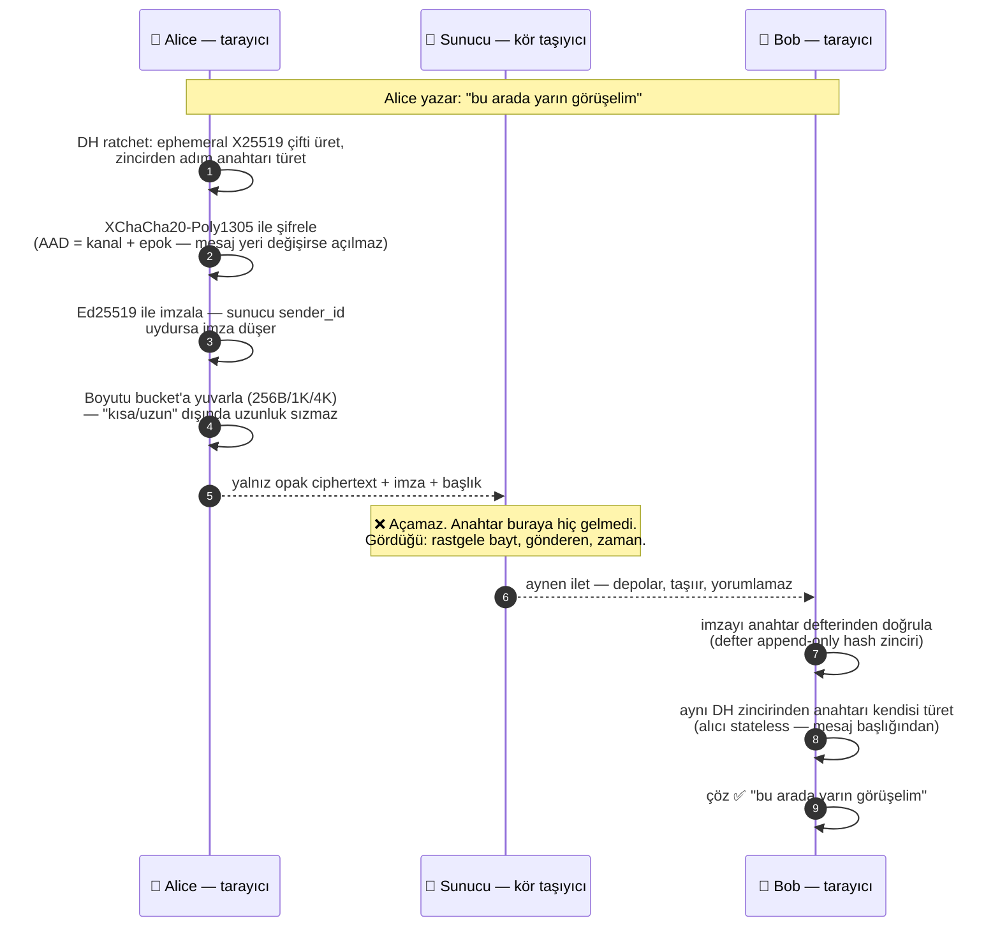
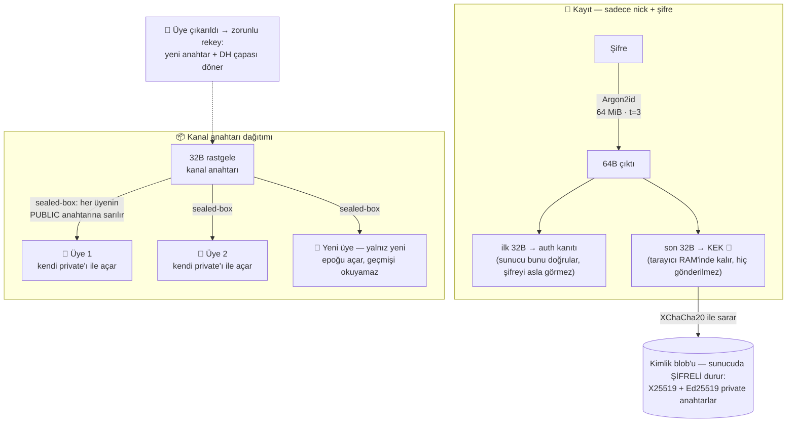

# postacim 🕊️

[](https://github.com/yucOx/postacim/actions/workflows/ci.yml)
[](#otomatik-testler)

Türkçe · **[English](README.md)**

Gizlilik odaklı, uçtan uca şifreli (E2EE) Discord-benzeri sohbet uygulaması.
Sunucu yalnızca şifreli veri taşır — mesajların, sesin, görüntünün ve anahtarların
düz hâlini **hiçbir zaman** görmez.

Canlı örnek: **https://postacim.dev** · Masaüstü uygulaması: [postacim-cli](#masaüstü-uygulaması)

| Masaüstü | Mobil |
|---|---|
|  |  |

## Özellikler

- **Kayıt: sadece nick + şifre** — e-posta/telefon yok, zero-knowledge; kayıt sırasında **BIP-39 kurtarma ifadesi** ritüeli (12 kelime, 3'ünü doğrulama, metin dosyası indirme) — şifre kaybında kimlik ve geçmiş kurtarılır
- **Yazı odaları** — XChaCha20-Poly1305 ile istemci tarafında şifreli, gerçek zamanlı (WebSocket)
- **Kaybolan mesajlar** — composer'dan mesaj başına TTL (kapalı / 1 saat / 1 gün / 1 hafta), kanal ve DM/grup başına hatırlanır; süre dolan mesajlar sunucuda tombstone'a çevrilir, istemcide "süresi doldu" olarak görünür (TTL sunucu için metadata — bkz. Bilinen sınırlar)
- **Sesli/görüntülü odalar** — LiveKit SFU üzerinde SFrame ile gerçek E2EE, onlarca katılımcı
- **Topluluklar** — Discord benzeri sunucu → kanal yapısı, sahip/üye rolleri
- **Anahtar dağıtımı** — kanal anahtarları her üyeye sealed-box ile sarılır; sunucu açamaz
- **Üye çıkarma = rekey (zorunlu)** — çıkarılan/banlanan üyeden sonra kanallar **kilitlenir**: yazışma, ses odası, davet üretimi/kullanımı ve yeni üye ekleme, sahip veya admin "anahtarı yenileyene" kadar kapalıdır (eski anahtar risk altında olduğundan). Atılan üye elindeki davetle geri dönüp okuyamaz; sesli odadaysa canlı bağlantısı düşürülür.
- **Şifre değiştirme** — kimlik blob yeniden sarılır, kanal anahtarları etkilenmez; değişince **tüm oturumlar düşer** (çalınan token da dahil)
- **Çoklu cihaz** (Faz 7) — her cihaz bağımsız X25519+Ed25519 keypair (kimlik blob'u v3, `device_id`); Ayarlar → Cihazlar sekmesinden cihaz listesi, WS tabanlı linking (primary onayı), cihaz iptali = zorunlu rekey. Per-cihaz DH step: aynı kullanıcının farklı cihazları farklı adım sayacı tutar (F5 per-sender modelinin doğal uzantısı) — bir cihazdaki state sızıntısı diğerini etkilemez
- **Ekran paylaşımı** — aynı E2EE hattı üzerinden; **Go Live diyaloğu**: çözünürlük × fps × kaynak tipi (ekran/pencere/sekme) × sekme/sistem sesi seçimi, Discord'un bitrat hedeflerine eşlenen tablo. Tarayıcı sınırı: pencere paylaşımı hiçbir platformda ses taşımaz; Linux'ta ekran da taşımaz (yalnız sekme + "sekme sesini de paylaş" kutusu) — ses track'i olmayan yayınlar izleyicide "sessiz yayın" rozetiyle görünür, Go Live diyaloğu Linux'ta önceden uyarır
- **Arama deneyimi** (Discord düzeni) — odak/ızgara sahne geçişi, konuşmacı parlaması, arama içi yan sohbet (split-view), köşeye küçültme (PiP — sürükle + her şeyin üstünde pin), **her şeyin üstünde arama penceresi** (Document PiP — tarayıcıda ve masaüstü uygulamasında OS seviyesinde always-on-top), **sağ tık menüsü**: kişi başına ses seviyesi/susturma ve yayın sesi kontrolü, kontrol çubuğunda ping göstergesi, **doğrulanmış yayıncı rozeti** (Ed25519 imzalı kimlik duyurusu)
- **Mobilde arka plan** — arama sürerken sekme arka plana alınınca ses hattı sessiz bir keepalive + MediaSession ile canlı tutulur (Android mikrofonu kesmez, Chrome otomatik PiP tetikleyebilir); kamera açık + PiP yoksa yayın dürüstçe "kamera kapalı"na döner — karşı taraf donuk kare yerine temiz sinyal görür —, ön plana dönünce otomatik geri açılır. Presence da korunur: mobil OS presence WS'ini kapatsa bile sunucu 120 sn grace ile kullanıcıyı odada tutar, istemci yeniden bağlanınca durumu yeniden duyurur. **iOS dürüst sınırı:** Safari arka planda kamerayı hiçbir web uygulamasına akıttırmaz (native uygulama gerekir); mikrofon keepalive ile çoğu zaman sürer
- **Cihaz seçimi** — mikrofon/kamera/hoparlör; arama içi menüden veya Ayarlar → Ses ve Video'dan, seçim kalıcı (hoparlör tercihi aramalar arasında saklanır ve sonradan katılanlara da uygulanır), arama sırasında değişince anında uygulanır
- **Bildirim sesleri** (Discord paritesi) — 15 olay: mesaj, mention, gelen arama, davet, arkadaşlık isteği, oda giriş/çıkış, mikrofon aç/kapa, yayın aç/kapa, kamera aç/kapa, tüm sesi kıs/aç. Her biri Ayarlar → Bildirimler'den **tek tek kapatılabilir** ve Dinle düğmesiyle önizlenir; melik olanlar MP3, kısa tık desenleri WebAudio ile sentezlenir

### Moderasyon ve katılım

- **Roller**: sahip → admin → üye. Admin: üye ekleme/atma+rekey, ban, kanal, davet, başvuru onayı. Admin atama ve katılım şifresi yalnız sahipte. Üye ekleme **onaylıdır**: hedef kullanıcıya davet penceresi açılır, kabul etmeden üyelik basılmaz.
- **Topluluk profili**: sahip/admin ⚙️'den topluluk adını değiştirir, fotoğraf ekler — kanal adları gibi düz metadata'dır, anahtarlara dokunmaz; yalnız üyeler görür.
- **Kalıcı ban**: banlı üye yeniden eklenemez, davet kullanamaz, başvuramaz; ban listesi ⚙️ altından yönetilir.
- **Davet linkleri** (`↗` → üret): **açık** davet — geçici X25519 anahtarın özel yarısı linkin `#` fragmentında taşınır, sahip offline olsa bile katılım çalışır; **hedefli** davet — anahtarlar doğrudan hedefin kimliğine sarılır, kod sızsa bile başkası kullanamaz. Kullanım sayısı/süre sınırı, iptal.
- **Başvurular**: topluluk adını bilen başvurur (`↗`); sahip/admin onaylayınca anahtarlar onun kimliğine sarılır; red sonrası tekrar başvurulabilir.
- **Katılım şifresi** (sahip, ⚙️ → Şifre): davet linkine ek ikinci faktör. Argon2id ile türetilen anahtar kanal anahtarlarını sarar — sunucu yalnızca verifier görür.
- **Topluluklar gizlidir**: hiçbir yerde listelenmez; yalnız üyeler görür. Ad bilmek başvuru için giriş sinyalidir.

### Arkadaşlar, özel mesaj ve arama

- **Arkadaşlık** (🕊️): nick ile istek gönder; kabul/red. Sadece arkadaşlar DM açabilir — tanımadığın biri mesajlayamaz.
- **Özel mesaj (DM)**: iki kişilik E2EE kanal; anahtar açan taraf tarafından iki kimliğe sealed-box ile sarılır, DM mesajları `dm:` kapsamlı AAD ile XChaCha20-Poly1305 şifrelidir. Arkadaşlık bitince gönderim kapanır, geçmiş okunur kalır.
- **Grup DM** (🕊️ → + grup): arkadaşlarından grup kur; üye eklerken/ayrılırken anahtar yenilenir — yeni üye eski mesajları, ayrılan üye sonraki mesajları **okuyamaz**; kalan üyeler tüm geçmişi epoch anahtarlarıyla okur.
- **1:1 arama**: DM'de 📞 — karşı tarafta zil (WebAudio) + kabul/red; kabulde her ikisi LiveKit odasına aynı DM anahtarıyla SFrame E2EE bağlanır. Meşgulse otomatik red. Sen ayrıldıktan sonra karşı taraf odada bekliyorsa DM'de yeşil **"aramada"** bandı + tek tuşla katıl (F5 sonrası da görünür).
- **Okunmadı**: kanal/DM listelerinde nokta+sayaç, 🕊️ rozeti, sekme başlığında `(n)`, arka plan DM'lerinde bildirim sesi. Okuma durumu yalnız istemcide — sunucu neyi okuduğunu bilmez.

## Nasıl çalışır? — kimse mesajlarınızı göremiyor

Sunucu bir postanedir: zarfları taşır, ama **hiçbir zarfı açamaz**. Her katman
kör design edilmiştir — ağ dinleyicisi TLS'e, sunucu şifreye, medya sunucusu
SFrame'e takılır. Aşağıda bir mesajın nick yazıldığı andan karşı tarafta
okunduğu ana kadar gerçek akışı var. Bunun animasyonlu web sürümü — giriş
gerektirmeyen anlatım sayfası — uygulamanın `/#/nasil-calisir` adresinde.

### 1. Bir mesajın yolculuğu



Sunucunun veritabanında bu mesaj **böyle** durur — [elle test](#elle-test-iki-tarayıcı-profili)
adımındaki komutla kendin bak:

```
{ nonce: '9f3a1c…', ciphertext: 'c8e2b41d77a0f6…' }   ← içinden hiçbir şey okunmaz
```

### 2. Anahtarlar tarayıcıdan hiç çıkmaz



Şifre kaybolursa: BIP-39 kurtarma ifadesi (12 kelime) kimliği geri getirir —
ifade de uçtan uca sarılı olduğundan **sunucu onu da açamaz**; her şey
kaybolursa hesap geri gelmez, bu E2EE'nin bedelidir.

### 3. Ses, görüntü ve ekran paylaşımı aynı hattı izler

```mermaid
flowchart LR
    MIC["🎤 Alice<br/>mikrofon/kamera/ekran"] -->|"tarayıcıda SFrame<br/>çerçeve çerçeve şifreler"| C1["🔒 şifreli RTP"]
    C1 --> SFU["LiveKit SFU<br/>— medya sunucusu<br/>yalnız opak bayt yönlendirir"]
    SFU --> C2["🔒 şifreli RTP"]
    C2 -->|"anahtar = H(DH zinciri ‖ 'voice')<br/>yayın çerçevelerine ek sıfır bilgi"| EAR["🎧 Bob"]
    style SFU fill:#1a1a2e,stroke:#888
```



Ses odası anahtarı mesaj zincirinden türetilir (`H(step_root ‖ 'voice')`) —
yani "kanalı okuyabilen herkes sesi de duyar, başkası duyamaz". SFU'nun
gördüğü: bayt. Ne söylendiğini, ne paylaşıldığını göremez.

### 4. Kim ne görüyor, kim ne göremiyor?

| | Gören | Göremeyen |
|---|---|---|
| **Ağ dinleyici** (ISP, WiFi) | TLS trafik boyutu/zamanı | içerik, nick, anahtar |
| **Sunucu** (kötü niyetli olsa bile) | opak ciphertext, gönderen kimliği, zaman, boyut bucket'ı | mesaj, ses, görüntü, anahtar, şifre |
| **LiveKit SFU** | şifreli çerçeve baytları, kim kime bağlı | konuşulan/paylaşılan içerik |
| **Başka üye** (gruptan atılan) | atılana kadar olanı bilmese de geçmiş epok anahtarları elindeyse geçmiş | rekey sonrası **hiçbir yeni mesaj** (DH-rekey + PCS-lite) |

> Kanıt makinada değil, **matematikte**: XChaCha20-Poly1305 ve X25519 açmak
> için anahtar gerekir; anahtar yalnız üyelerin tarayıcısında türetilir ve
> hiçbir noktaya şifresiz iletilmez. Sunucunun "görememe" iddiası testle de
> sabit — `server/test/hardening.test.ts` veritabanında plaintext oluşumunu
> otomatik reddeder, her CI çalışmasında.

## Kripto mimarisi

| Amaç | Yöntem |
|---|---|
| Şifreden anahtar türetme | Argon2id (64 MiB, t=3), 64B çıktı: ilk 32B auth kanıtı (sunucuda argon2id verifier), son 32B KEK (tarayıcıdan çıkmaz) |
| Kimlik | X25519 keypair + **Ed25519 imza keypair**; private key'ler KEK ile XChaCha20-Poly1305 şifreli blob olarak sunucuda. **Blob evrimi:** v1 = X25519 priv; v2 = `0x02 ‖ X25519 ‖ Ed25519` (Faz 1); v3 = `0x03 ‖ X25519 ‖ Ed25519 ‖ 16B device_id` (Faz 7). Eski blob'lar ilk açılışta otomatik son sürüme yükselir; v1/v2 hesaplar `deviceId = null` ile primary alias olarak devam eder |
| Kanal anahtarı | 32B rastgele; üyelere `crypto_box_seal` (sealed box) ile sarılı |
| Mesajlar | XChaCha20-Poly1305, AAD = `ch:<kanal>:v<epok>` (yeniden konumlandırmaya dayanıklı) |
| Gönderen atfı | Her mesaj gönderenin **Ed25519 anahtarıyla imzalı** (`ciphertext‖signature`, imza ciphertext+AAD üzerinden); alıcı açmadan önce anahtar defterinden doğrular — sunucu sahte sender_id ile mesaj uyduramaz. Cutover tarihinden sonraki imzasız mesajlar reddedilir |
| DH ratchet (v4, tüm scope'lar) | Her mesajda açık taşınan ephemeral X25519 public + DH çıktısı zincire karışır; adım 100 mesajda / 24 saatte bir yenilenir, ephemeral private atılır → **çalınan güncel zincir state'i bir sonraki adımdan itibaren geleceği üretemez** (forward secrecy). DM'de DH karşıtı (ben, peer) sıralı çiftinden türetilen deterministik çapa (`dhAnchor` — 5b hotfix; kendi mesajımız da açılır); kanal/gdm'de epok anahtarından türetilen grup DH çapası — tüm üyeler aynı çifti türetir, alıcı stateless kalır: mesaj başlığından zincir yeniden türetilebilir (F5/pagination/localStorage kaybı doğal). Çapa düzeltmesinden önceki v4 DM'leri okunamaz (bir kez yazılan format değişmez) |
| Ses/görüntü | SFrame anahtarı kanal anahtarının DH zincirinden türetilir (5d): `H(step_root ‖ 'voice')` — kanal sesi epok DH çapasının kendi üstündeki X25519'üne, DM araması iki tarafın statik kimlik DH'ine bağlı; epok başına sabit, rekey ile döner. SFU opak bayt görür |
| Anahtar epokları | `key_version`; eski epoklar saklanır → rotasyon öncesi geçmiş okunmaya devam eder |
| Per-gönderici ratchet | `msg_key_i` zinciri `H(epok anahtarı ‖ 'ratchet' ‖ sender_id)` kökünden türetilir; güncel zincir kökü sızarsa geçmiş korunur (geri türetim yok). Tüm scope'lar bu kökü v4 DH adımıyla birleştirir (yukarıdaki satır) |
| DH-rekey broadcast + self-update | Üye değişiminde rotate yeni epoku kalan üyelere sarmalayarak dağıtır — çıkarılan üye eski epok bilgisiyle (anahtar + çapa + tüm başlıklar elinde olsa bile) gelecekteki mesaj anahtarlarını türetemez. Ele geçirilen cihazın yerini alan kurban, yeni DH public'ini Ed25519 imzalı `dh_update` duyurusuyla yayınlar (WS relay — sunucu opak geçirir, saklamaz); alıcı imzayı anahtar defterinden doğrur, geçerliyi TOFU pin'ler. Duyuru Ayarlar → Güvenlik'ten tek tıkla yayınlanır (5d); imza doğrulamasını geçemeyen duyuru kırmızı güvenlik bandı tetikler — çöp frame (bozuk biçim/bilinmeyen gönderen) sessizce reddeilir, bant spam'lenmez |
| Mesaj padding | plaintext boyut bucket'larına (256 B / 1 KiB / 4 KiB / 4 KiB-adım) yuvarlanır — sunucu mesaj uzunluğundan içerik çıkarımı yapamaz |
| Cihaz kilidi (ops.) | WebAuthn PRF'ten türeyen cihaz KEK'i ile blob IndexedDB'de — F5'te parmak izi, şifre fallback akışı korunur |
| Cihaz başına kimlik (Faz 7) | Her cihaz bağımsız X25519 + Ed25519 keypair (kimlik blob'u v3 = X25519 priv + Ed25519 priv + 16B device_id); kullanıcı kimliği `users` + `users_devices` (v17) — primary kayıt anında, linked cihazlar primary tarafından onaylanır. Sunucu private key/identity blob saklamaz; yalnız public key + cihaz adı + linking durumu. Cihaz iptali = rekey zorunlu: iptal edilen cihaz yeni mesajları açamaz (eski private'ı yeni DH çıktısını üretemez), eski mesajlar eski anahtarla okunabilir kalır. Per-cihaz DH step: aynı kullanıcının farklı cihazları farklı adım sayacı tutar (F5 per-sender modelinin doğal uzantısı), farklı ephemeral, farklı DH pub başlığı — alıcı için ayrı gönderici. Per-cihaz fingerprint: peer'ın `users_devices.public_key + sign_public_key`'i ile çalışır; primary ve linked cihazlar farklı sayılar üretir |
| Anahtar defteri | public key'ler append-only hash zincirinde (`key_log`); istemci boot'ta zinciri doğrular, head damgası profilde bant dışı karşılaştırma için. İmza anahtarları da defterden dağıtılır — yalnız zincir bütünlüğü kanıtlanmış kayıtlar imza doğrulamasına beslenir. **Bant dışı checkpoint:** CI günlük defter ucunu repoya yazar (`keylog-checkpoint.json`); istemci açılışta kendi zinciriyle karşılaştırır — kötü sunucu tek-online kurgana fork defter gösterse bile en geç bir gün içinde çelişki yakalanır |
| Medya gönderen atfı | Odadaki her katılımcı LiveKit identity'sini Ed25519 ile imzalayıp duyurur (`voice:attest` — sunucu opak relay); alıcı imzayı defterden doğrular, identity'nin odaya gerçekten bağlı olmasını şart koşar. Doğrulanmış yayıncının plakasında kalkan rozeti; kötü sunucunun bastığı hayalet identity imzasız kalır → rozet çıkmaz |
| Kendi mesajımızı kendimiz açar (Faz 1 hotfix) | `chatStore`/`dmChatStore` `toDisplay`, gönderen biz isek RAM'deki `authStore.signPublicKey`'i kısayol olarak kullanır (`resolveSignKeys`) — keytransparency sync beklenmeden kendi mesajımız decode olur. Başkaları için yalnız zincir kanıtı geçerli; model bozulmaz. |
| Keylog gossip | her istemci doğrulanmış head'ini 5dk'da bir üyesi olduğu topluluklara WS ile yayınlar; aynı id farklı hash = fork kanıtı → kırmızı bant. Sunucu opak relay (saklama/yorum yok) — invariant korunur. Tam CONIKS kanıt zinciri yok: gözlemsel, bant dışı damga karşılaştırması hâlâ en güçlü kanıt |

> **Bilinen sınırların güncel ve sınıflandırılmış hâli** (KAPATILDI / KISMEN / AYNI / GELECEK etiketleriyle) [aşağıda](#tehdit-modeli-ve-bilinen-sınırlar) ayrı bölümde. Oturum httpOnly+SameSite=Strict çerezle taşınır (XSS çalamaz), CSP/HSTS dahil; TLS için `docker-compose.tls.yml` overlay'i hazır — ağ üzerinden erişimde mutlaka kullan.

## Mimari

```
posta-guvercini/
├── server/   Node 22 + Fastify + SQLite — Bearer auth, WS (/ws), LiveKit token
│             (çok aşamalı Dockerfile: tsc derlemesi + node dist)
├── web/      React 19 + Vite + Tailwind — tüm kripto tarayıcıda (libsodium, hash-wasm)
│             (Dockerfile: vite build → nginx; /api ve /ws reverse proxy)
└── livekit/  LiveKit SFU (Docker) — medyayı çözmeden iletir
```

## Deploy (tek komut)

```bash
cp .env.example .env          # isteğe göre düzenle (aşağıda)
docker compose up -d --build  # livekit + server + web
```

- Web arayüzü: `http://<sunucu-ip>/` (port `.env` → `WEB_PORT`)
- Doğrulama: `curl http://localhost/api/health` → `{"ok":true}`
- Veritabanı: `./data/` volume — yedekle/sil, her şey orada

### Doğrulama: JS integrity (release manifest)

Web JS'i sunucudan dağıtılır; kötü bir sunucu değişmiş JS ile anahtar çalabilir
(bkz. [Tehdit modeli](#tehdit-modeli-ve-bilinen-sınırlar)). Bu sınır
**azaltılır**: her `v*` tag'inde CI, web bundle'ın SHA-256 manifest'ini GitHub
Release asset'i olarak yayınlar — `INTEGRITY.txt` (`sha256sum -c` biçimi) ve
`INTEGRITY.sri.txt` (SRI: `sha256-<base64>`, `integrity=""` özniteliği için).
Kendi sunucunun yaydığı dosyaları manifestle karşılaştır:

```bash
TAG=vX.Y.Z                                        # GitHub Releases'deki tag
BASE=https://github.com/yucOx/postacim/releases/download/$TAG

# 1) Manifest'i GitHub'dan al — sunucundan DEĞİL (bant dışı kanal şart)
curl -fsSLO "$BASE/INTEGRITY.txt"

# 2) Sunucunun yaydığı her dosyayı manifest listesine göre indir
mkdir -p dist-check && cd dist-check
while read -r _ path; do
    mkdir -p "$(dirname "$path")"
    curl -fsS "https://<sunucunuz>/${path#./}" -o "$path"
done < ../INTEGRITY.txt

# 3) Karşılaştır — tüm satırlar OK olmalı
sha256sum -c ../INTEGRITY.txt
```

- `FAILED` satırı, sunucunun release derlemesinden farklı (veya değiştirilmiş)
  JS yaydığını gösterir.
- `INTEGRITY.sri.txt`, dosyaları başka bir origin'den
  `<script integrity="...">` ile yükleyenler içindir.
- Kendi fork'unu derleyenler aynı listeyi `npm run integrity` ile yerelde
  üretip kendi derlemesini doğrular.

**Dürüst sınır:** bu karşılaştırma JS trust'ı azaltır, kapatmaz. Kötü sunucu
manifest'i de değiştirebilir — sunucudan gelen bir manifest kanıt değildir;
karşılaştırma manifest'i GitHub Release üzerinden alarak yapılmalı. Derleme
reproducible değildir: manifest belirli bir release derlemesine aittir, aynı
kaynağın iki ortamda bit-bit aynı çıktısı garanti edilmez. Tarayıcı uzantısı
(manifest v3, yalnız hash kontrolü) opsiyonel artı olarak roadmap'te durur —
karar kullanıcıda.

### Prod VPS: state'i repodan ayır (önerilen)

Public sunucuda gerçek secret'lar (`LIVEKIT_SECRET`, `node_ip`) repoya
girmez — gitignored `.env` ve `livekit/livekit.yaml`, `/etc/postacim/`
altında tutulur, her `git pull` sonrası post-merge hook otomatik restore
eder:

```bash
sudo cp .env.example /etc/postacim/.env && sudo chmod 600 /etc/postacim/.env
sudo cp livekit/livekit.yaml.example /etc/postacim/livekit.yaml
# /etc/postacim/* dosyalarını kendi değerlerinle düzenle, sonra:
bash scripts/deploy-state.sh restore   # state'i repoya kopyala + diff raporu
docker compose up -d --build
```

- `scripts/deploy-state.sh status|diff|restore` — state kontrolü,
  `.env.example` ile alan farkı raporu (yeni env alanı geldiğinde uyarır)
- Post-merge hook kurulumu ve sıfırdan VPS kurulumu:
  [deploy/vps-fresh-install.md](deploy/vps-fresh-install.md)

**`.env` ayarları:**
- `LIVEKIT_URL` — tarayıcının LiveKit'e ulaşabildiği adres. Web proxy'si `/livekit`
  yolunu SFU'ya ilettiği için aynı origin kullanılır: sunucu makinesinde
  `http://localhost/livekit`; LAN erişimi için `http://<sunucu-ip>/livekit`
  (TLS modunda `https://<sunucu-ip>/livekit`).
- `LIVEKIT_API_KEY` / `LIVEKIT_SECRET` — LiveKit ile server'ın ortak anahtarı;
  prod için güçlü çift üret: `docker run --rm livekit/livekit-server:v1.13.1 generate-keys`
  (bilinen örnek değerlerde sunucu açılmayı reddeder)
- `WEB_PORT` — web'in yayın portu (default 8080)
- `SCREEN_SHARE` — `off` yapılırsa ses token'larından ekran paylaşım izni
  (`screen_share` publish kaynağı) düşer: istemci UI'ı yine de görebilir ama
  yayın LiveKit'te fiziksel olarak reddedilir. Acil durum kill switch'i —
  değiştirince yalnız `docker compose up -d server` yeniden başlatmak yeter.

### Medya: kalite, limitler ve optimizasyon

İstemci tarafı (tarayıcıda çalışır, sunucu transcode yapmaz — SFU yalnız iletir):

- **Simulcast + Dynacast + AdaptiveStream** (`voiceStore.connectRoom`): gönderici
  2-3 kalite katmanı basar; SFU her izleyiciye yalnız bant genişliğine ve tile
  boyutuna uyan katmanı yollar, kimse izlemiyorsa katman durur (Discord'un Go
  Live mimarisiyle aynı üçlü).
- **Ekran paylaşımı VP9** codec'li: metin/UI içeriği VP8'e göre ~yarı bitratete
  aynı netlik taşır. Kamera VP8 kalır (tarayıcı VP9 simulcast desteği zayıf).
  E2EE (SFrame) codec-agnostiktir — paketlemeden önce şifreler.
- **`contentHint`**: ekran track'ine `detail` (netlik koru), kameraya `motion`
  (akıcılık koru) — tarayıcı encoder'ına ücretsiz ipucu.
- **Kalite katmanları** (kalite seçici: hızlı/dengeli/yüksek) `degradationPreference`
  ile: hızlı kare hızı koruyup çözünürlükten, yüksek çözünürlük koruyup kareden
  kırpılır. Yayın diyaloğu tavanı 1080p30 (1440p bilinçli kapalı — tek yayıncı
  küçük SFU'yu doldurabilir), varsayılan 720p30.
- **TEST AŞAMASI: kamera 720p tavanlı** — 'yüksek' katman farkı yalnız ekran
  paylaşımında (1080p30). Kapasite oturunca `voiceStore.qualityTiers`'da
  `yuksek.camCapture/camPublish` `VideoPresets.h1080`'e döndürülür; UI'daki
  "1080p ileride açılır" notu (`call.cam720Note`) o zaman kaldırılır.

Sunucu tarafı (token ile zorlanır — UI'ı aşamaz):

- **Oda limitleri** her ses token'ına gömülü (`RoomConfiguration`): oda başına
  12 katılımcı (2 vCPU/3 GB hedefi, 12×11=132 downtrack), boşalan oda
  5 dakikada kapanır. Yük artarsa önce `maxParticipants` düşürülür, sonra
  LiveKit ayrı host'a taşınır.
- **`SCREEN_SHARE=off`** kill switch (yukarıda) — token grant seviyesinde.
- E2EE (SFrame) stream başına ~%10 encoder/decoder CPU maliyeti koyar; gizlilik
  vaadinin bilinçli bedelidir, kaldırılamaz.

### 2 vCPU / 3 GB hedef optimizasyonları

2 vCPU/3 GB RAM VPS'te 50-80 ses → 120-150 ses, 30-50 video → 60-80 video:

- **CPU pinning** (`docker-compose.yml` `cpuset: "0"`/`"1"`) — LiveKit core 0,
  server core 1; context switch + cache miss sıfır, %15-25 throughput artışı
- **WS broadcast batching** (`server/src/ws/hub.ts`, 16 ms tick + dedup) — 50 kişilik
  odada 2500 broadcast/sn yerine ~800 broadcast/sn
- **LOG_LEVEL=warn** (`.env` + `server/src/index.ts`) — JSON serialize + I/O %5-10 azalır
- **Publisher cap 1.5 Mbps** (`web/src/state/voiceStore.ts` `publishDefaults.videoEncoding.maxBitrate`)
  — 4K yayınlayan encoder 1.5 Mbps'ye sıkışır, SFU CPU korunur; gizlilik etkisi yok
  (SFrame zaten içeriği şifreli)
- **Netdata prod'da kapalı** (`docker-compose.yml` `profiles: [monitoring]`) — 50-100 MB RAM
  kurtarır; geliştirme için `docker compose --profile monitoring up -d`
- **TURN açık** (global kitle, 4G/CGNAT erişim için) — E2EE sayesinde gizlilik etkisi yok
  (TURN operatörü sadece metadata görür, içerik göremez)

> LiveKit v1.13.x server'da `publisher_max_bitrate` ve `simulcast_layers` alanları
> **yok** (v2.x'te eklendi); bu yüzden uplink sınırı ve simulcast **client tarafında**
> uygulanır (publishDefaults + adaptiveStream + dynacast).

### Arayüz dili (i18n)

5 dil: Türkçe, İngilizce, Almanca, Fransızca, İspanyolca. İlk açılışta tarayıcı
diline bakılır (`tr*` → Türkçe, diğerleri → İngilizce); seçim localStorage'da
saklanır, dil seçiciye giriş ekranının sağ üstünden ve üst başlıktaki dünya
ikonundan erişilir. Yeni dil eklemek: `web/src/i18n/types.ts` union'ına kod,
`locales/<kod>.ts` katalog dosyası; anahtar eksikliği `locale-parity` testini
kırdığı için CI'da yakalanır.

Güncelleme: `./scripts/deploy.sh` (build + up + livekit restart + health
kontrolleri tek komut; `.env` yoksa üretir, anahtar çiftini basar). Eşdeğeri:
`git pull && docker compose up -d --build`.

### Host nginx + certbot (elle kurulum, compose dışı)

Varsayılan mod: docker servisleri yalnız `127.0.0.1`'de yayınlanır (`web` →
`127.0.0.1:8080`, `server` → `127.0.0.1:4000`); dış dünyaya tek giriş host
nginx'tir (`deploy/nginx-postacim.conf` — kurulum adımları dosyanın başında).
XFF'yi yazan tek yer host nginx'tir (`$remote_addr` overwrite) — server
`trustProxy:true` leftmost okuduğu için forged XFF rate-limit'i aşamaz.

```bash
sudo cp deploy/nginx-postacim.conf /etc/nginx/sites-available/postacim
sudo ln -s /etc/nginx/sites-available/postacim /etc/nginx/sites-enabled/
# server_name'i düzenle, sonra:
sudo nginx -t && sudo systemctl reload nginx
sudo apt install certbot python3-certbot-nginx
sudo certbot --nginx -d postacim.example.com   # 443 + redirect otomatik
```

Host nginx'siz hızlı LAN modu: `.env`'de `WEB_HOST=0.0.0.0` — bu modda docker
web'in nginx'i XFF'yi kendisi yazar, internete doğrudan açma.

**Not:** `livekit/livekit.yaml` gitignored state'tir (şablon:
`livekit/livekit.yaml.example`; prod'da `/etc/postacim/livekit.yaml`) ve
bind-mount'tur; livekit servisi image'dan koştuğu için `up -d --build`
config değişince onu **yeniden başlatmaz** — livekit config'ine dokunan
güncellemelerden (ör. `prometheus_port`) sonra ayrıca
`docker compose restart livekit` çalıştır.

### İzleme (kapasite takibi)

Üç katman; "kaç kişi kaldırdığını" bilmek için hepsi birbirini tamamlar:

1. **Uygulama sayaçları** — `GET /api/stats` (oturum gerekli, yalnız toplam
   sayılar): kayıtlı kullanıcı, son 24 saatte açılan oturum, açık WS bağlantısı,
   sesli peer, aktif DM araması, SFU oda + katılımcı sayısı. Kapasite merdiveni:
   ~40 eşzamanlı görüşme → rahat; ~60 → varsayılan kaliteyi düşür; ~80+ →
   LiveKit'i ayrı host'a taşı.
2. **LiveKit metrikleri** — `livekit.yaml`'da `prometheus_port: 6789` açık;
   `curl localhost:6789/metrics` (yalnız localhost — dışarıya açma). Track,
   oda, bayt ve paket sayaçları.
3. **Makine metrikleri (Netdata, opsiyonel)** — compose profili, grafik
   dashboard'u: `docker compose --profile monitoring up -d` →
   `http://localhost:19999` (**yalnız 127.0.0.1'e bağlı** — dış erişim yok).
   2 vCPU/3 GB prod hedefinde varsayılan kapalıdır (~50-100 MB RAM). Uzaktan
   bakmak için SSH tüneli:
   `ssh -L 19999:localhost:19999 <sunucu>`. CPU, RAM, disk IO, ağ ve tüm
   Docker container'ları saniye bazında; eşik alarmı Netdata ayarlarından
   (ör. CPU %70 → Discord webhook) bağlanır. Sistem içlerini ifşa ettiği
   için **domain'e asla açıkta oturtma** — auth'suz subdomain bile olmasın.

### HTTPS/WSS (TLS overlay)

Ağ üzerinde şifrelenmemiş bağlantı `auth_material` + oturum çerezini taşır — gizlilik
ürününde TLS şart. Self-signed ile (kendi LAN'ında):

```bash
cp .env.example .env                      # anahtar çiftini üret/gir (yukarıda)
./scripts/gen-certs.sh                    # certs/ altına localhost + makine IP'li sertifika
# .env içinde: LIVEKIT_URL=https://<makine-adı-veya-ip>/livekit
docker compose -f docker-compose.yml -f docker-compose.tls.yml up -d --build
```

- 80 → 443 yönlendirme, HSTS, CSP ve diğer güvenlik başlıkları nginx'de hazır
- Doğrulama: `curl -skI https://localhost/ | grep -i strict-transport`
- LiveKit sinyali de (`/livekit` → WSS) aynı sertifika üzerinden proxylanır; medya
  zaten DTLS/SRTP ile şifreli
- Herkese açık dağıtımda self-signed yeterli değildir — Let's Encrypt gibi gerçek
  sertifika kullan (`certs/` yerine mount et)

## Masaüstü Uygulaması

Kod ayrı repoda: **[yucOx/postacim-cli](https://github.com/yucOx/postacim-cli)** — Electron sarmalayıcı, ince istemci (web uygulaması sunucudan yüklenir, Discord modeli). Tepsiye gizlenme, okunmamış sayacı, http LAN'da secure-context muafiyeti, ekran/pencere kaynak seçici, otomatik güncelleme, sistemle başlatma. Sürümler `desktop-v*` etiketinde AppImage + deb + exe + dmg olarak CI'dan yayınlanır.

## Geliştirme (konteynersiz)

Gereksinimler: Node 22+, Docker.

```bash
npm install
docker compose up -d livekit      # yalnız LiveKit (localhost:7880)
npm -w server run dev             # API  (localhost:4000)
npm -w web run dev                # Web  (localhost:5173)
```

Doğrulama: `curl localhost:4000/api/health` → `{"ok":true}`

## Otomatik testler

```bash
npm test    # 339 test: kripto/istemci birim + kara kutu entegrasyon (geçici sunucu + geçici DB)
```

- `web/src/crypto/crypto.test.ts` — AEAD/AAD bağlama (kanal/sürüm/kapsam değişince reddetme), kimlik sarma, BIP-39 checksum, davet linki ayrıştırma, şifre güç heuristiği, kurtarma quiz konumları, WS reconnect backoff sınırları, okunmadı sayacı
- `web/src/crypto/fingerprint.test.ts` — safety number simetrisi, bilinen vektörler (v1 X25519 + v2 imza anahtarı katkılı), biçim
- `web/src/crypto/signature.test.ts` — gönderen atfı: imza doğrulama, sahte gönderici reddi, ciphertext/AAD modifiye reddi, bilinmeyen imza anahtarı reddi, cutover geçiş davranışı, imza düşürme (downgrade) reddi
- `web/src/csp.test.ts` — nginx CSP'nin WASM kripto uyumu (wasm-unsafe-eval), HSTS yalnız TLS conf'da
- `web/src/lib/replay.test.ts` — client_id tekrar oynatma filtresi (aynı kanalda yinelenen id reddi)
- `web/src/lib/safety.test.ts` — safety number sıra bağımsızlığı/biçim
- `server/test/auth.test.ts` — kayıt/giriş, IP başına limitler, httpOnly çerez (+ Secure bayrağı TLS arkasında) + WS çerez auth, logout iptali, şifre değişimi oturum düşürme, BIP-39 kurtarma döngüsü
- `server/test/messages.test.ts` — geçmiş sayfalama imleci, kullanıcı başına (IP değil) gönderim limiti, rotate kadro doğrulaması
- `server/test/moderation.test.ts` — roller, kick→dondur→rotate, ban, kanal limiti
- `server/test/join.test.ts` — açık/hedefli davet, süre/kullanım limiti, başvurular, katılım şifresi
- `server/test/social.test.ts` — arkadaşlık, DM, grup DM rekey, WS canlı olay + sesli durum yayını
- `server/test/dmvoice.test.ts` — DM arama presence (`dm:voice`): duyuru peer'a gider, bayat yanlış-kanal kapatması yok sayılır, üye olmayan yayınlayamaz, register anlık görüntüsü (F5)
- `server/test/keyloghead.test.ts` — checkpoint ucu: oturumsuz erişim, head/count defterle tutarlı
- `server/test/attest.test.ts` — voice:attest relay: oturum/boyut/kanal-tip doğrulaması, topluluk broadcast + DM peer iletimi, üye olmayan 404
- `server/test/noise.test.ts` — dummy trafik: oturum zorunlu, boyut sınırı, rate limit, saklama yok
- `server/test/boot.test.ts` — zayıf secret reddi, taze DB migration zinciri
- `web/src/crypto/ratchet.test.ts` — per-gönderici ratchet: zincir tek yönlülüğü, index/AAD reddi, stateless yeniden türetim, out-of-order
- `web/src/crypto/dh-ratchet.test.ts` — DH ratchet (v4): KAT vektörleri (`dh-ratchet.vectors.json`), FS/PCS-lite sızıntı simülasyonu (gönderici state sızıntısı → eski adım kapalı, sonraki adım güvenli), adım içi backward secrecy, out-of-order, tarama sınırı, AAD/imza/başlık takası negatifleri, self-update doğrulama, 5c: epok DH çapası (kanal/gdm roundtrip) + rekey broadcast negatifleri (atılan üye broadcast'i yakalasa da geleceği açamaz), 5d: ses anahtarı türetimi (çapa/DM KAT, iki tarafın aynı anahtarı, epok ayrımı, mesaj zincirinden alan ayrımı)
- `web/src/lib/dhupdate.test.ts` — self-update duyuru işleme: kanon ayrıştırma, yanlış Ed25519/bozuk kanon reddi, kanal/epok bağlama, TOFU pin, bant eşlemesi (yalnız imza red bant tetikler)
- `server/test/dhupdate.test.ts` — WS `dh_update` opak relay: kanal/gdm/dm kitlesi, üye olmayan reddi, sığ payload sınırı, plaintext invariant (satır/tablo oluşmaz), relay→ingest uçtan uca (geçerli + bozuk imza)
- `web/src/crypto/devicekey.test.ts` — cihaz kilidi: blob sar/çöz, yanlış KEK/AAD reddi, enroll→unlock, PRF fallback
- `web/src/crypto/identity.test.ts` — v3 kimlik blob'u: deviceId ile seal+open, v1/v2 geriye uyumlu açılış, yanlış KEK reddi
- `web/src/lib/dhstep-device.test.ts` — per-cihaz DH step namespace: aynı (channel, version) farklı deviceId = ayrı sayaç, pencere mantığı deviceId-bağımsız
- `web/src/lib/keytransparency.test.ts` — anahtar defteri: zincir bütünlüğü, kopuk/çelişkili head reddi, kendi kayıt kontrolü
- `server/test/hardening.test.ts` — log hijyeni (query/IP düşmez), WS auth zaman aşımı (4004), login kademeli bloğu
- `server/test/keylog.test.ts` — anahtar defteri: genesis/kuyruk hash, sayfalama, silinen hesabın satırı kalır, UPDATE/DELETE yolu yok
- `server/test/devices.test.ts` — cihaz yönetimi: GET liste, link 3-adım flow (start/approve/finish), primary iptal reddi, joinee iptal, token tek kullanımlık, başka user cihazı iptal 404
- `server/test/delete.test.ts` — hesap silme: kimlik/mesaj/DM/grup/topluluk tek transaction, kurucu devri
- `.github/workflows/ci.yml` — push/PR'da tip kontrolü + tüm testler

## Elle test (iki tarayıcı profili)

1. Profil A: kayıt ol (ör. `alice`) → topluluk oluştur → `genel` yazı odasına mesaj yaz
2. Profil B: kayıt ol (`bob`) → Alice üye listesinden `+` ile bob'u ekle
3. Bob otomatik topluluğu görür; iki taraf şifreli sohbet eder
4. Sesli odaya tıkla → mikrofon/kamera izni → iki profil aynı odada E2EE görüşür
5. Sahip bob'u çıkarır → kanallar rekey; bob yeni mesajları göremez
6. Kanıt: `node -e "console.log(require('better-sqlite3')('data/posta.db',{readonly:true}).prepare('SELECT nonce,ciphertext FROM messages LIMIT 3').all())"` — yalnızca opak veri

## Güvenlik notları

- Rate limit: kayıt 3/sa, giriş 5/dk, lookup/kdf-params 20/dk, mesaj 60/dk (kullanıcı+IP kovaları ayrı); pencere içi art arda başarısız girişte IP başına kademeli blok (1→15 dk, `LOGIN_FAIL_FREE`=10 serbest kredi)
- Oturum token'ları DB'de sha256; 7 gün TTL (env ile ayarlanabilir); süresi geçenler saatlik janitor ile temizlenir
- WS: ilk kare auth zorunlu (aksi halde 4001 ile kapanır; frame hiç gelmezse 10 sn'de 4004 ile kesilir), maxPayload 1 MiB, ping reaper
- Uygulama logu URL'yi query'siz yazar — nick/istemci IP'si log'a düşmez (nginx access log'u ayrı, operatör kapatabilir)
- Dev: localhost secure context; ağ erişimi için [TLS overlay](#httpswss-tls-overlay) — repo'da hazır
- LiveKit anahtarları `.env` üzerinden livekit (`--keys`) ve server'a aynı anda dağıtılır — tek kaynak

## Tehdit modeli ve bilinen sınırlar

> v1.0.0 için sıfırdan sınıflandırma (Faz 8). Yol haritasının 6 boşluğu
> (Faz 1–7) bu komut dizisiyle kapatıldı; kalan sınırlar aşağıda
> **KAPATILDI / KISMEN / AYNI / GELECEK** etiketiyle dürüstçe ayrıldı.
> Dış audit için paket: [docs/SECURITY-REVIEW.md](docs/SECURITY-REVIEW.md).

### Aktörler

- **Sunucu**: kör ama kötü niyetli olabilir (malicious-server model).
  İçeriği görmez, **görmemesi gerektiğini** kanıtlayan invariant testle
  sabit (`server/test/hardening.test.ts`).
- **Ağ pasif dinleyici**: TLS overlay ile kapatılır
  ([HTTPS/WSS](#httpswss-tls-overlay) — self-host için `docker-compose.tls.yml`).
- **Ağ aktif (MITM)**: TLS + sertifika pin (tarayıcı CA deposu); onion
  varyantı için [deploy/tor-hidden-service.md](deploy/tor-hidden-service.md).
- **Cihaz üzerindeki saldırgan**: çalınmış tarayıcı, malware, fiziksel
  erişim — kapsam dışı (SECURITY.md "Kapsam dışı").

### 1. Roadmap boşluklarının akıbeti

| # | Boşluk (orijinal ifade) | Akıbet | Kanıt |
|---|---|---|---|
| 1 | Gönderen atfı kriptografik değil — `sender_id` sunucu kolonu | **KAPATILDI** (Faz 1) | `web/src/crypto/signature.test.ts` — imza doğrulama, sahte gönderici reddi, ciphertext/AAD modifiye reddi; cutover sonrası imzasız mesaj reddi |
| 2 | Kaybolan mesajlar yok (UX/gizlilik beklentisi) | **KAPATILDI** (Faz 2) | `web/src/lib/ttl.test.ts` + `crypto/ttl-aad.test.ts` + `server/test/ttl.test.ts` — TTL seçici, AAD dışı, janitor tombstone, WS süresi geçen frame reddi; PRİVACY.md'ye metadata notu |
| 3 | IP metadata (istemci/sunucu) | **KISMEN** (Faz 3 — rehber, kapanmaz) | `deploy/tor-hidden-service.md` — v3 onion + https-onion rehberi; istemci IP'si onion arkasında gizlenir, sunucu IP'si DNS/sertifika kayıtlarından çıkar; rehber uygulanmazsa sınır AYNI |
| 4 | Web JS trust — kötü sunucu değişmiş JS ile anahtar çalabilir | **KISMEN** (Faz 4 — azaltım, kapanmaz) | `scripts/bundle-hashes.sh` + `.github/workflows/release.yml` — her `v*` tag'inde bundle SHA-256 + SRI manifest GitHub Release asset'i; [Doğrulama](#doğrulama-js-integrity-release-manifest); sınır AYNI: kötü sunucu manifest'i değiştirebilir (karşılaştırma bant dışı kanaldan) |
| 5 | Forward secrecy kısmi — DH ratchet/MLS bekleyen kurul | **KAPATILDI** (Faz 5, **PCS-formel değil**) | `web/src/crypto/dh-ratchet.test.ts` — KAT vektörleri, FS/PCS-lite sızıntı simülasyonu, adım içi backward secrecy, out-of-order, self-update doğrulama, epok DH çapası + rekey broadcast negatifleri, ses anahtarı türetimi; spec: `docs/faz5-dh-ratchet-design.md` + `docs/faz5-ratchet-research.md` |
| 6 | Tam anti-forking — istemciler arası gossip gerektirir | **KAPATILDI** (Faz 6, **gözlemsel**) | `web/src/lib/keygossip.test.ts` (4 durum makinesi) + `web/src/lib/keytransparency.test.ts` + `server/test/keygossip.test.ts` (relay invariant, sığ sınır, plaintext invariant); spec: `docs/faz6-keygossip-design.md`; sınır AYNI: CONIKS/Keybase MAP kanıt ağacı yok |
| 7 | Tek kimlik blob'u (cihaz iptali yok) | **KAPATILDI** (Faz 7) | `web/src/crypto/identity.test.ts` (v3 blob) + `web/src/lib/dhstep-device.test.ts` (per-cihaz DH step) + `server/test/devices.test.ts` (12 link/revoke flow); spec: `docs/faz7-multidevice-design.md` |

### 2. Kalan sınırlar (kapanmış boşluk değil — yapısal/kaynak kısıtı)

- **Web JS trust kalıntısı (Faz 4 azaltımı sonrası)** — AYNI.
  Kötü sunucu manifest'i de değiştirebilir; karşılaştırma manifest'i
  bant dışı kanaldan (GitHub Release) almalı. Derleme reproducible
  değil: manifest tek bir release derlemesine bağlı. Tarayıcı uzantısı
  (manifest v3, yalnız hash kontrolü) opsiyonel artı — karar kullanıcıda.
  (KEK memory-only: reload'da şifre yeniden istenir; opsiyonel passkey
  cihaz kilidi blob'u cihaz donanımından türeyen anahtarla saklar —
  zararlı JS ancak aktif WebAuthn onayıyla kullanır.)
- **Tor rehberi opsiyonel (Faz 3)** — AYNI. Sunucu operatörü rehberi
  uygulamazsa istemci/sunucu IP'si açık. Onion varyantı düz http'de
  `Secure=false` çerez üretir (karar rehberde yazılı).
- **Rate-limit anonimleştirme** — AYNI (Faz 3'te keşfedilen yapısal sınır).
  Anonim istekler IP kovasına düşer; onion arkasında tüm kullanıcılar
  tek kova → birbirini sınırlandırır (kayıt 3/sa, giriş 5/dk).
  `trustProxy:true` + nginx `$remote_addr` overwrite ile XFF spoof
  kapatıldı; onion arkasında IP anonimdir ama ortak kova nedeniyle
  bireysel hedefleme zorlaşır (yan etki: aynı çıkış düğümündeki
  anonimler birbirini yavaşlatır). TURN açıkken TURN operatörü IP
  eşlemesi görebilir — E2EE içerik gizli kalır, metadata görünür.
- **Sansür/sıralama** — AYNI. Kör sunucu mesaj gizleyebilir, sıralamayı
  ve timestamp'i manipüle edebilir. Client binding (UUID + client
  timestamp) AAD'ye bağlı → tespit edilebilir, engellenemez.
- **Metadata** — AYNI. Sosyal graf (kim kiminle), zamanlama, mesaj
  boyutu (bucket padding'iyle seviyesi indirilir), presence, çağrı
  katılım/mute durumu, topluluk/kanal/üye listesi, roller, davet
  metadata'sı sunucuda görünür. Kaybolan mesajların `expires_at`'ı
  içerik değil ama ömür bilgisi (PRIVACY.md'ye yazıldı). Dummy trafik:
  giriş yapmış istemci 1–10 dk rastgele aralıklarla 32 B–4 KiB
  anlamsız blob POST eder (`/api/noise`, saklanmaz) — mesaj gönderim
  zamanlaması tek başına ayırt edilemez.
- **MLS-formel yok** — GELECEK tetikleyicisi. Şu an PCS-lite
  (per-sender DH + epok rekey penceresi M=100 / T=24h + self-update
  + cihaz iptali = rekey). Rekey/self-update frekansı toparlanma
  penceresini sınırlar; alıcı kimlik private'ı sızarsa gözlemlenen
  mesajlar açılır (stateless türetimin bedeli). `dh_update` duyurusu
  Ed25519 imzalı, TOFU pin, WS opak relay. Kanal/gdm'de epok anahtarı
  sızarsa o epoğun zinciri + çapası baştan türetilebilir; DM'de
  (5b hotfix) sıralı (sender, peer) çiftinden türetilen DM çapası
  + ephemeral silinmesi birlikte epok sızıntısına karşı korur.
  Tetikleyici: openmls-wasm stabil sürüm + IndexedDB storage docs
  + resmî npm paketi → Faz 9'da yeniden değerlendirilir.
- **Faz 5b hotfix: v4 DM geriye dönük kırılganlık** — KISMEN. 5b
  çıktığından bu yana gönderilen DM'ler kimlik-çifti türevi
  (X25519(eph, peer_static_pub)) ile şifrelendi; yeni sürüm çifti
  sorted(sender, peer) çiftinden türetilen DM çapasına
  (X25519base(H(epoch‖'dm-anchor'‖…))) çevirdiğinden eski v4 DM'ler
  yeni istemcide okunamaz (AEAD reddi → body null → "anahtar bu
  epoch" mesajı). Geçiş: yeni mesajlar yeni formatla; kullanıcı
  geçmiş DM'leri yeniden göndermeli. Kanal/gdm etkilenmedi (5c
  çapası zaten doğruydu).
- **Ses/görüntü gönderen atfı** — KAPATILDI (bağlantı kimliği düzeyinde).
  Odadaki katılımcı LiveKit identity'sini Ed25519 ile imzalayıp duyurur
  (`voice:attest` opak relay); alıcı imzayı anahtar defterinden doğrular +
  identity'nin odaya bağlı olduğunu şart koşar. Kötü sunucu hayalet
  identity basabilir ama onun adına imza üretemez → plakada kalkan rozeti
  çıkmaz. Kalan dürüst sınır: rozet kullanıcı dikkatine dayanır (doğrulan
  madış yayıncıya kör güvenilmez); SFrame çerçeve içine gömülü imza yok —
  çerçeve düzeyinde ayrım yoktur.
- **WebRTC medya Tor'dan geçmez** — AYNI (Faz 3). Sesli/görüntülü
  arama ve ekran paylaşımı UDP (LiveKit ICE) taşır; Tor SOCKS
  üzerinden akmaz. Mesajlaşma onion'da tam çalışır; aramada medya
  doğrudan gider (tarafların IP'si çağrı esnasında açılır) ya da
  kapalı moda alınır: `SCREEN_SHARE=off` + medya portları kapalı.
- **Key transparency gossip gözlemsel (Faz 6)** — KISMEN. Tam CONIKS
  kanıt ağacı yok; iki online istemci aynı toplulukta etkileşirken
  çelişkiyi görür, çevrimdışı çatışma çözümü bant dışı damga
  karşılaştırmasıdır (profildeki 16 hex). Tek online kurgan için ek savunma:
  **günlük bant dışı checkpoint** — CI defter ucunu bu repoya yazar
  (`keylog-checkpoint.json`), istemci açılışta karşılaştırır; fork en geç
  bir gün içinde kanıtlanır. Kalan pencere: checkpoint anı ile açılış
  arasında fork edilib geri toplanan kısa süreli saldırılar.
- **Çoklu cihaz linking MVP (Faz 7)** — GELECEK. WS tabanlı onay iki
  cihazın aynı anda online olmasını gerektirir; async QR/off-band
  linking roadmap'te. Primary cihazın tam kaybı hesap erişimini
  kilitler (kurtarma ifadesi tek çıkış).
- **Şifre + kurtarma ifadesi ikisi birden kaybolursa** — AYNI.
  Hesap kurtarılamaz (ifade kimlik gibi uçtan uca sarılı — sunucu
  açamaz). Yapısal sınır; e2e şifreleme bunu gerektirir.
- **DB at-rest şifreleme (SQLCipher)** — GELECEK. Bilinçli ertelendi:
  E2EE içeriği zaten koruyor, metadata katkısı marjinal, better-sqlite3
  derlemesi imajı kırılganlaştırır. Operatör isterse LUKS/dm-crypt
  ile volumes-layer koruma uygulayabilir.
- **Nick enumeration** — AYNI. Login/kurtarma pseudo-salt ile kapalı;
  kalan kanal kayıt sırasındaki "nick alınmış" (rate-limited).
- **DM anahtarları** — AYNI. Arkadaşlık bitse de taraflarda kalır
  (geçmiş okunabilir, gelecek okunamaz — grup/DM anahtarı yenilenmediği
  sürece).
- **Session TTL** — AYNI. 7 gün (env ile ayarlanabilir); şifre değişimi
  tüm oturumları düşürür.

## Durum

- [x] Faz 0 — iskelet
- [x] Faz 1 — auth + kimlik blob (kayıt/giriş, zero-knowledge)
- [x] Faz 2 — topluluk/kanal/üye + sarılı anahtar dağıtımı
- [x] Faz 3 — E2EE yazı sohbeti
- [x] Faz 4 — LiveKit sesli/görüntülü odalar (E2EE)
- [x] Faz 5 — cilalama (rekey, şifre değiştirme, ekran paylaşımı)
- [x] Paket A-D — roller/ban, davet linkleri, başvurular, katılım şifresi
- [x] Paket E-G — arkadaşlık, DM, grup DM (rekey'li), 1:1 arama, okunmadı
- [x] Sprint 1 — bütünlük: per-user limitler, pending rekey, LiveKit eviction, oturum düşürme
- [x] Sprint 2 — TLS/HSTS + CSP + httpOnly çerez + WS dayanıklılık
- [x] Sprint 3 — BIP-39 kurtarma ritüeli + şifre UI + branded dialoglar
- [x] Test turu — otomatik test + CI (bugün: 33 dosya, 315 test)
- [x] Sprint 4 — sertleştirme: mesaj padding + Trusted Types + bundle hash betiği, log hijyeni, WS auth timeout, login kademeli bloğu, passkey cihaz kilidi, per-gönderici ratchet, anahtar defteri (key transparency)
- [x] UI/UX turu — Discord-parite arama düzeni: odak/ızgara + PiP, cihaz seçimi, olay bazlı ses sistemi (15 olay), onaylı üye ekleme, topluluk profili (bugün: 38 dosya, 339 test)

**Sıradaki — güvenlik yol haritası** ([SECURITY-ROADMAP.md](SECURITY-ROADMAP.md)):
kripto/gizlilikte Signal paritesine 8 fazlı program.

- [x] Faz 1 — Ed25519 imzalı mesajlar (gönderen atfı kriptografik)
- [x] Faz 2 — kaybolan mesajlar (disappearing messages)
- [x] Faz 3 — Tor hidden service rehberi (IP metadata)
- [x] Faz 4 — signed release / reproducible build (JS trust azaltma)
- [x] Faz 5 — DH ratchet (kendi implementasyon: per-sender DH + epok rekey penceresi + self-update; DM/kanal/gdm/ses; PCS-formel değil — dürüst sınırlar tehdit modelinde; araştırma: docs/faz5-ratchet-research.md, spec: docs/faz5-dh-ratchet-design.md)
- [x] Faz 6 — key transparency gossip (anti-forking, gözlemsel — 5dk periyodik WS + JIT; spec: docs/faz6-keygossip-design.md)
- [x] Faz 7 — çoklu cihaz (per-cihaz X25519 + Ed25519, v3 blob, WS tabanlı linking, per-cihaz DH step + fingerprint, cihaz iptali = rekey; spec: docs/faz7-multidevice-design.md)
- [x] Faz 8 — threat model sıfırdan + dış audit hazırlığı (v1.0.0 — tag kararı kullanıcıda; paket: docs/SECURITY-REVIEW.md + docs/AUDIT-FUNDING.md)

## Katkıda bulunma

Geliştirme kurulumu, test akışı, i18n parite kuralı ve PR beklentileri:
[CONTRIBUTING.md](CONTRIBUTING.md). Topluluk davranış kuralları:
[CODE_OF_CONDUCT.md](CODE_OF_CONDUCT.md). Güvenlik açığı bildirimi (özel kanal):
[SECURITY.md](SECURITY.md) — lütfen güvenlik sorunlarını public issue
olarak açmayın.

## Lisans

[AGPL-3.0-or-later](LICENSE) — GPLv3'ün ağ kullanımına kapalı türevi:
bu sunucunun değiştirilmiş bir sürümünü hizmet olarak işletirseniz,
kaynak kodunu kullanıcılarına sunmak zorundasınız. Gizlilik aracının
sunucu varyantının kapanmaması bilinçli bir tercihtir (Signal'in izlediği
yol). © 2026 yuxor.ltd
